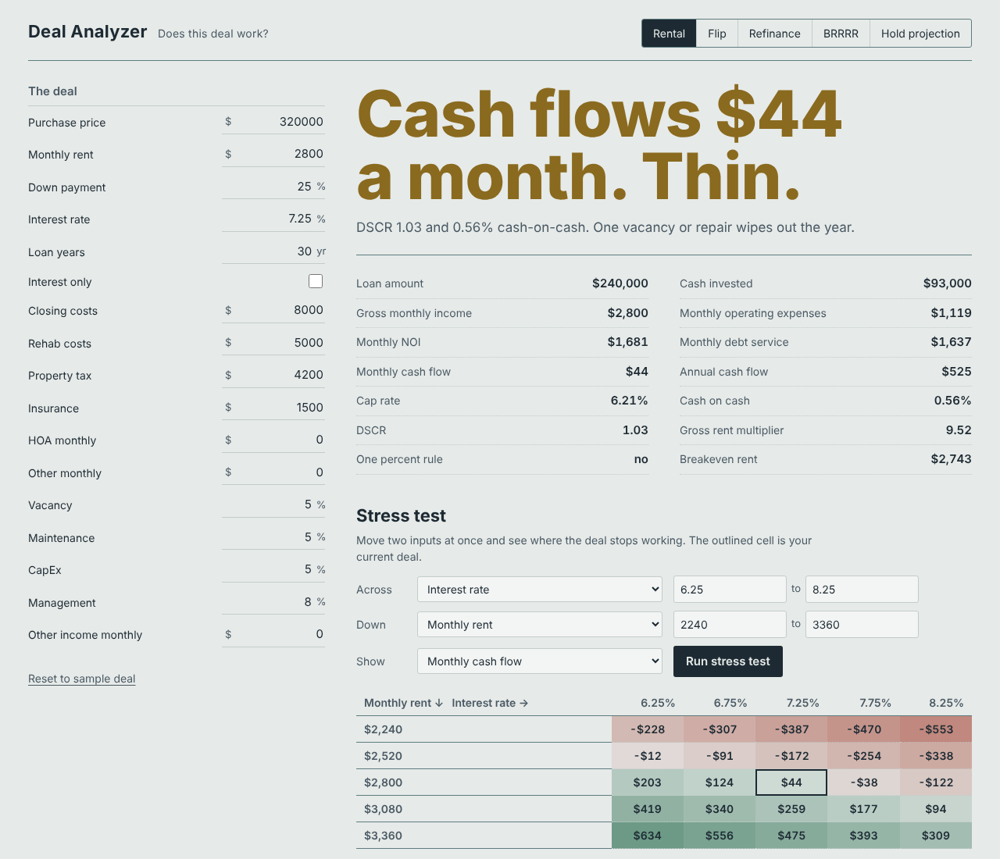

# DataFinance (deal-analyzer)

Underwrite real estate deals before you make an offer. Run buy-and-hold rentals, fix-and-flips, cash-out / DSCR refinances, full BRRRR cycles, and multi-year hold projections with IRR, from the command line or a local web app. Pure Python, no runtime dependencies.



## Install

```bash
git clone https://github.com/sbose7/DataFinance.git
cd DataFinance
pip install -e ".[dev]"
```

Requires Python 3.10+.

## Web app

```bash
deal-analyzer serve            # http://127.0.0.1:8000
```

Pick an analysis, edit the inputs, and the answer updates as you type. Each analysis gets:

- **A verdict** in plain words, such as "Cash flows $44 a month. Thin."
- **Every metric** the engine computes.
- **A stress test** that moves two inputs at once and shades where the deal breaks.
- **Pinned deals** to compare versions side by side (stored in your browser).
- For hold projections, **a chart** of value against loan balance, with a yearly table.

The page talks to the same Python engine as the CLI, so the numbers always match.

## Command line

Every analysis takes a JSON file of inputs. `examples/` has one for each.

```bash
deal-analyzer rental   examples/rental.json
deal-analyzer flip     examples/flip.json
deal-analyzer refi     examples/refi.json
deal-analyzer brrrr    examples/brrrr.json
deal-analyzer project  examples/project.json --years 15 --appreciation 0.03 --csv hold.csv
deal-analyzer compare  rental examples/rental.json examples/rental_cheaper.json --sort-by cash_on_cash
deal-analyzer sensitivity rental examples/rental.json \
    --x interest_rate=0.06:0.08:0.005 --y monthly_rent=2600:3000:100 --metric monthly_cash_flow
deal-analyzer amortize 240000 0.0725 30 --months 12 --csv schedule.csv
```

Add `--json` to any analysis for machine-readable output.

### Hold projection

```
Hold projection
---------------
  Yr   Income      NOI     Debt  Cash flow  Loan bal     Value    Equity    CoC
  --  -------  -------  -------  ---------  --------  --------  --------  -----
   1  $33,600  $20,172  $19,647       $525  $237,677  $336,375   $98,698  0.56%
   ...
  10  $43,840  $26,320  $19,647     $6,673  $207,145  $458,445  $251,300  7.18%

Exit summary
------------
  Net sale proceeds     $223,793
  Total profit          $165,576
  Equity multiple       2.78
  IRR                   11.37%
```

### Sensitivity

Axes take `field=start:stop:step` or `field=a,b,c`. Projection assumptions use dotted paths:

```bash
deal-analyzer sensitivity project examples/project.json \
    --x projection.appreciation=0.02,0.03,0.04 --y projection.rent_growth=0.02,0.03,0.04 --metric irr
```

```
Sensitivity: IRR
----------------
  Rent growth \ Appreciation  2.00%   3.00%   4.00%
  2.00%                       7.55%   9.61%  11.51%
  3.00%                       8.49%  10.44%  12.26%
  4.00%                       9.45%  11.30%  13.04%
```

## What each analysis calculates

| Analysis | Metrics |
|---|---|
| `rental` | NOI, cash flow, cap rate, cash-on-cash, DSCR (NOI / debt), GRM, 1% rule, breakeven rent |
| `flip` | Total project cost, cash required, net profit, ROI and annualized ROI, margin on ARV, 70% rule max offer |
| `refi` | Loan sized by the tighter of LTV and DSCR, cash out, cash left in deal, post-refi DSCR (rent / PITIA) |
| `brrrr` | Acquisition loan and carry costs, refi loan and cash out, cash left in deal, post-refi cash flow and cash-on-cash |
| `project` | Year-by-year income, NOI, debt service, cash flow, loan balance, value, equity; sale proceeds, IRR, equity multiple |
| `compare` | Any of the above for several deals, ranked by the metric you choose |
| `sensitivity` | Any output metric over a grid of any two inputs |
| `amortize` | Month-by-month principal, interest, balance |

### Assumptions worth knowing

- Rates and percentages are decimals in JSON (`0.07` = 7%). The web app shows them as percents.
- Rental expenses split into percent-of-rent (vacancy, maintenance, capex, management) and fixed (tax, insurance, HOA).
- Flip and BRRRR acquisition loans are modeled as interest-only hard money with points. Set `loan_to_cost` to `0` for all cash. Flips add a rehab contingency (10% by default).
- Refi DSCR uses the common investor-loan definition, rent ÷ PITIA. `monthly_expenses_ex_debt` covers the T, I, and A.
- Projections grow rent and percent-based expenses at `rent_growth`, and fixed expenses at `expense_growth`. The sale happens at the end of the last year, at the appreciated value minus `selling_cost_pct`.
- The web app's verdicts are rules of thumb, not lending standards. A rental needs DSCR ≥ 1.2 and positive cash flow, a flip needs profit ≥ 10% of ARV, and a hold needs IRR ≥ 8%.

## Use as a library

```python
from deal_analyzer import RentalDeal, ProjectionAssumptions, analyze_rental, project, sensitivity

deal = RentalDeal(purchase_price=320_000, monthly_rent=2_800, property_tax=4_200, insurance=1_500)
print(analyze_rental(deal).monthly_cash_flow)
print(project(deal, ProjectionAssumptions(years=10, appreciation=0.035)).irr)

grid = sensitivity("rental", {"purchase_price": 320_000, "monthly_rent": 2_800}, "monthly_cash_flow",
                   "interest_rate", [0.06, 0.07, 0.08], "monthly_rent", [2_600, 2_800, 3_000])
```

## Project layout

```
src/deal_analyzer/
  mortgage.py     payment, balance, amortization
  finance.py      NPV, IRR, JSON cleanup
  rental.py       buy-and-hold
  flip.py         fix-and-flip
  refi.py         LTV / DSCR loan sizing
  brrrr.py        acquisition -> rehab -> refi -> rent
  projection.py   multi-year hold and exit
  kinds.py        registry shared by compare, sensitivity, and the web app
  sensitivity.py  two-variable grids
  compare.py      side-by-side ranking
  server.py       stdlib HTTP server and JSON API
  web/index.html  the web app
  cli.py          command line
```

Adding a new analysis means writing its module and adding one entry to `kinds.py`. The CLI's `compare` and `sensitivity` commands and the web app pick it up automatically.

## Development

```bash
pytest
```

GitHub Actions runs the suite on Python 3.10 through 3.13 for every push.

## License

MIT
